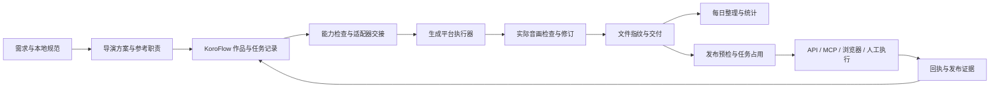

# KoroFlow 架构与实施边界

## 工作流、适配器与执行器

核心保存跨平台不变的作品事实：`work_id`、角色/内容、Brief、参考职责、修订、指纹、质量检查、交付、采用、任务与成本。平台选择和每日目标留在用户配置，不写死私人角色或账号数量。

`scripts/koroflow.py` 是仓库入口；实现位于 `skills/koroflow/scripts`，安装后可独立使用。它只进行本地文件和记录操作，没有隐式网络执行。`scripts/workflow.mjs` 保留现有海艺/Hypit 执行能力，`scripts/operations.py` 保留旧工程、账号与统计预检。

适配器描述 transport、status、operations、capabilities 和 handoff。能力检查不会推测一个服务拥有所有功能；`reference_video` 也不等于严格视频编辑。`implemented` 表示仓库已有对应执行路径，`external` 依赖外部技能/工具，`manual` 人工操作，`unconfigured` 不参与候选。每次实际任务仍需确认模型与连接可用。

无限画布可作为外部制作平台接入；画布节点、素材 ID 和导出任务可放在请求/回执中。核心无需依赖特定画布结构。当前示例仅提供交接契约，尚未实现任何新画布执行器或社交平台自动发布器。

## 存储与身份

用户工作空间 `.koroflow` 内包含 config、quality、adapters、targets 和 UUID 事件。写入使用独占锁、追加事件和原子文件替换；事件 sequence 检查中间缺号与重复。异常退出留下锁时先检查 owner 与真实执行状态，不能自动抢占锁重试远程任务。该日志不提供备份或防篡改保证，仍需用户备份。

同一作品跨平台使用同一 `work_id`，不同付费尝试使用独立 task key，文件改动使用新 revision。登记文件不代表成功生成，任务成功不代表质量合格，通过检查也不等于已经交付。质量模板默认 `not_checked`，实际检查人/工具提供依据；交付核对当前必检项和文件 SHA256。

首交付日期按工作空间时区归属，修订不改变它。生成数只计已记录成功的视频生成/编辑任务，音频、图片、合成不混入视频生成数。交付按独立作品，采用必须有明确依据。各角色目标分别计算缺口；没有目标时不推定达标。当前制作状态是当前视图，不冒充过去日期的历史快照。

## 执行与结果未知

任务依次经历 prepared → submitted/running → succeeded，发布则完成为 scheduled 或 published。prepared 可转 result_unknown，用于远程已可能提交但回执丢失；未知任务保留占用，应先核实远程 ID 和结果，不能重新提交来“试试看”。取消、失败和跳过的任务释放本地占用。

请求保存路径和 SHA256；提交记录前再次检查请求及发布文件。远程 ID 确认后不能更换，同适配器远程 ID 不可登记成另一个任务。成功视频登记真实输出文件；发布不能以一般 succeeded 冒充完成。成本保留显式单位，不将未知平台积分擅自换算为人民币。

发布查重作用域是同一核心工作空间：同账号同作品或同文件 SHA 有未释放任务就拒绝再次分配。它不能拦截用户在其他系统直接上传；旧发布历史仍需 operations plan 检查。占用和提交记录也不能成为平台侧“恰好一次”执行保证，执行器须支持查单/幂等并保留真实证据。

## 兼容已有工程

旧工程保持原目录、编号和现有统计器，不强制迁移。显式 import-legacy 从 operations check --hash 报告引入一个可用已交付作品，保留选版、首交付日与采用状态；未知日期继续未知，不补造质量检查或生成事件。没有原工程的历史成片继续由原台账管理。

bridge 仅把真实开始、暂停、取消、交付、采用记录按 UUID 导出到原工程的 `项目文件/统计事件`，在交付后更新 `发布信息.json`。重复执行可恢复部分完成的导出，内容冲突拒绝覆盖。它不修改 Excel、手填发布字段，不自动刷新统计，也不导出伪造的生成任务。

原统计器继续识别其支持的生成任务来源。核心 report 只覆盖核心已记录的任务/作品，原 snapshot 覆盖旧统计口径；有重叠时不能直接相加。制作技能应依据实际工作空间选择记录和刷新方式，避免一条真实任务登记两次。

## 后续平台接入的交付要求

新增真实执行器应覆盖模型/能力查询、请求验证、提交、任务查询与恢复、输出下载及凭据隔离。发布执行器还需稳定账号标识、时区预约、平台作品 ID 与成功证据。使用临时项目和 mock 完成测试后，实时连通或付费验证仍按用户授权范围进行。没有这些实现和证据时，只能描述为可交接的外部路径。
